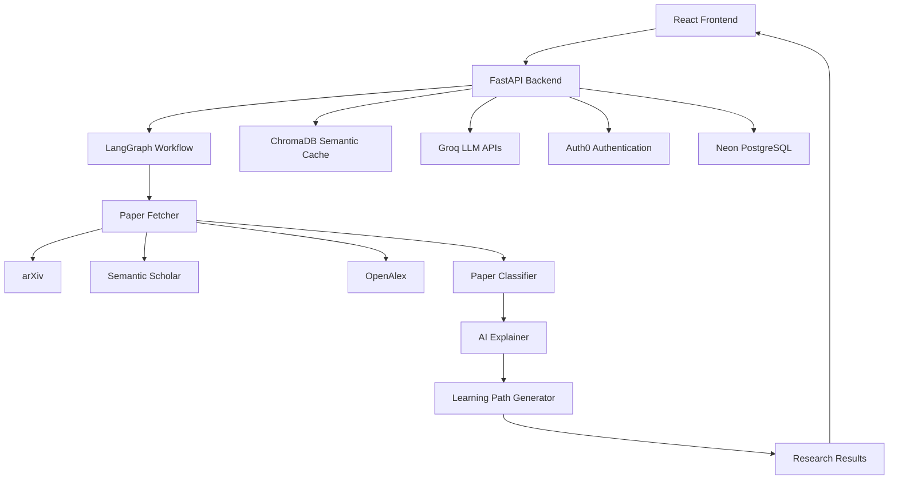

# SeekVerse-AI 🤖📚

**An AI-powered research assistant that helps you discover, understand, and explore academic research papers using multi-agent workflows and semantic retrieval.**

SeekVerse-AI simplifies academic research by searching multiple scholarly sources, classifying papers by difficulty, generating summaries, explaining research limitations, and creating personalized learning paths. It also provides AI-powered chat and paper comparison features to make complex research easier to understand.

## ✨ Key Features

- **🔎 Multi-Source Paper Search** — Discover academic papers using arXiv, Semantic Scholar, and OpenAlex.
- **🤖 Multi-Agent Research Pipeline** — Use LangGraph to coordinate specialized agents for fetching, classifying, explaining, and generating learning paths.
- **🧠 AI-Powered Summaries** — Generate beginner-friendly explanations, technical summaries, and research limitations.
- **📊 Difficulty Classification** — Categorize papers as Beginner, Intermediate, or Advanced.
- **🗺️ Personalized Learning Paths** — Organize relevant papers into a structured learning journey.
- **⚡ Semantic Caching** — Use ChromaDB to retrieve semantically similar cached research results and reduce repeated API calls.
- **💬 Interactive AI Chat** — Ask questions about research topics and explore ideas conversationally.
- **⚖️ Paper Comparison** — Compare research papers to understand their approaches and differences.
- **📝 Research Tools** — Analyze paper URLs, generate quizzes, and explore research concepts.
- **🔐 Authentication** — Integrate Auth0 authentication with JWT verification.
- **💾 Persistent User Data** — Store saved papers, notes, search history, and reading history in PostgreSQL.

## 🏗️ Architecture

The application combines a React frontend with a FastAPI backend and a LangGraph-based AI processing pipeline.



### How the AI pipeline works

1. **Fetch:** Retrieve relevant research papers from academic sources.
2. **Classify:** Categorize the papers according to their difficulty level.
3. **Explain:** Generate easy-to-understand explanations, technical summaries, and limitations.
4. **Generate a learning path:** Organize relevant papers into a logical learning sequence.
5. **Return results:** Send structured research results to the frontend for exploration.

LangGraph's `StateGraph` coordinates the workflow and passes shared research state between the processing nodes.

## 🛠️ Tech Stack

| Category | Technologies |
|---|---|
| Frontend | React, JavaScript, Framer Motion, D3.js, Axios |
| Backend | Python, FastAPI, Uvicorn |
| AI Orchestration | LangGraph, LangChain |
| Large Language Models | Groq API (Llama / Qwen) |
| Semantic Retrieval | ChromaDB |
| Embeddings | `all-MiniLM-L6-v2` |
| Authentication | Auth0, JWT, RS256, JWKS |
| Database | PostgreSQL (Neon), SQLite, SQLAlchemy |
| Research Data Sources | arXiv, Semantic Scholar, OpenAlex |
| Deployment | Uvicorn, environment-based configuration |

## 🧠 Semantic Caching with ChromaDB

Repeated research queries can be expensive and slow when they require external API calls and additional AI processing. SeekVerse-AI uses ChromaDB to semantically retrieve previously cached research results.

### How it works

1. A research query is converted into an embedding.
2. ChromaDB searches for semantically similar cached results.
3. When the cache contains sufficient relevant results, the application can reuse them.
4. Otherwise, the application fetches fresh research data and processes it through the AI workflow.
5. The resulting data can be stored for future retrieval.

**Embedding model:** `all-MiniLM-L6-v2`  
**Embedding dimensions:** 384  
**Chunk size:** 500 characters  
**Chunk overlap:** 100 characters  
**Cache threshold:** At least 3 unique papers for the configured cache-hit path.

The project uses a local `./chroma_db` directory for vector storage. Repeated-query testing indicated a latency reduction of over 90% in favorable cache-hit scenarios; actual performance depends on the query and cache state.

## 🔐 Authentication and Data Persistence

### Auth0

- JWT-based authentication.
- RS256 token verification using Auth0's JWKS.
- Just-in-time user creation or updating in the database.
- Protected backend operations for authenticated users.

### PostgreSQL & SQLite

The application supports Neon-hosted PostgreSQL (with SQLite local fallback) for persistent user-related data, including:

- Users
- Saved papers
- User notes
- Search history
- Reading history

SQLAlchemy ORM is used for database modeling and access.

## ⚙️ Getting Started

### Prerequisites

Make sure you have the following installed or configured:

- Node.js and npm
- Python 3
- A Groq API key
- Auth0 application credentials
- A PostgreSQL-compatible database, such as Neon
- API access to the academic sources you intend to use, where required

### 1. Clone the repository

```bash
git clone <YOUR_GITHUB_REPOSITORY_URL>
cd SeekVerse-AI
```

Replace the repository URL with your actual GitHub repository URL.

### 2. Configure the backend

Create and activate a Python virtual environment:

```bash
python -m venv venv
```

On Windows:

```powershell
.\venv\Scripts\Activate.ps1
```

On macOS or Linux:

```bash
source venv/bin/activate
```

Install the backend dependencies using the project's dependency file:

```bash
pip install -r backend/requirements.txt
```

Create a `.env` file in the location expected by the backend and configure the required credentials.

Example configuration (use the exact variable names expected by your code):

```env
GROQ_API_KEY=your_groq_api_key
AUTH0_DOMAIN=your_auth0_domain
AUTH0_AUDIENCE=your_auth0_api_audience
DATABASE_URL=your_database_url
```

Do not commit API keys, database credentials, or other secrets to GitHub.

### 3. Start the backend

From the project root, run:

```bash
uvicorn backend.api:app --reload --port 8001
```

The API should be available at:

`http://127.0.0.1:8001`

FastAPI's interactive API documentation is available at:

`http://127.0.0.1:8001/docs`

### 4. Start the frontend

Open a separate terminal and navigate to the frontend UI directory:

```bash
cd frontend/SeekVerse-ui
npm install
npm start
```

## 🔌 API Overview

The FastAPI backend exposes endpoints for the application's core functionality.

| Endpoint | Method | Purpose |
|---|---|---|
| `/` | GET | Health check / API status |
| `/search` | POST | Discover, synthesize, and classify research papers via multi-agent pipeline |
| `/chat` | POST | Ask conversational research questions about a paper using RAG context |
| `/compare` | POST | Compare two research papers (methodology, contributions, limitations) |
| `/quiz` | POST | Generate comprehension quizzes for a research paper |
| `/related` | POST | Fetch related research papers with relevancy filtering |
| `/explain` | POST | Explain a paper at different comprehension levels (child, student, expert) |
| `/analyze-url` | POST | Extract and analyze research papers from arXiv or web/PDF URLs |
| `/user/saved-papers` | GET / POST | List or save bookmarked research papers (Auth0 protected) |
| `/user/notes` | GET / POST / PUT / DELETE | Create, retrieve, update, and delete paper notes (Auth0 protected) |
| `/user/searches` | GET / POST | View and record search query history (Auth0 protected) |
| `/user/reading-history` | GET / POST | Track and inspect user reading history (Auth0 protected) |

## 🚀 Deployment

The backend is configured to run through Uvicorn and can be deployed on a compatible hosting platform.

Example production startup command:

```bash
uvicorn backend.api:app --host 0.0.0.0 --port $PORT
```

For deployment, configure the necessary environment variables, database connection, authentication settings, CORS origins, and frontend API URL in the hosting environment.

The ChromaDB storage directory must also be handled according to the deployment platform's persistence requirements.

## 🎯 Use Cases

- Students exploring unfamiliar research topics.
- Developers learning about emerging technologies.
- Researchers discovering related academic papers.
- Learners who need complex papers explained in simpler language.
- Users building a structured reading plan for a new subject.
- Anyone comparing approaches across academic research.

## 🔮 Potential Future Improvements

- Add more academic research sources.
- Improve semantic retrieval with metadata filtering and relevance evaluation.
- Introduce streaming responses for AI explanations.
- Add richer citation and reference management.
- Evaluate answer quality and retrieval accuracy using a repeatable benchmark.
- Add background processing for larger research workflows.

## 👩‍💻 Author

**Swastika Dey**

- GitHub: [https://github.com/Swastikad4](https://github.com/Swastikad4)

---
